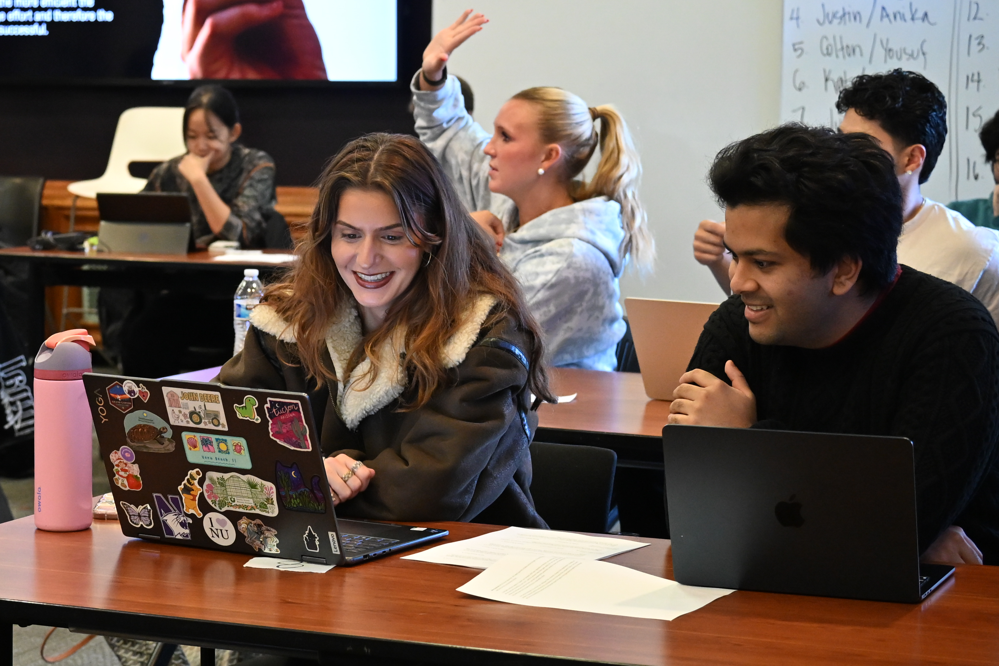

<!-- Paste your article below. Leave a blank line between paragraphs. -->
At the start of Winter Quarter of his senior year, Andy Grossman (SESP ’22) found himself “at a crossroads.” He was unsure whether to continue writing his SESP senior thesis and pursue the consulting job he had lined up or dive deeper into data analytics for Northwestern’s football team, where he was already volunteering.

Eventually, he chose football. With help from advisers and professors in NU’s Learning and Organizational Change program, he decided to fully devote himself to football analytics.
Grossman spent the rest of his senior year working with the ’Cats and building a portfolio of data analytics work to send to all 32 NFL teams. Just a week after graduation, he landed a full-time job with the Atlanta Falcons. 

“Things change all the time,” Grossman said. “But the guidance and support that I had from SESP… totally boosted my confidence and made me feel more comfortable making some of these bigger decisions.”
LOC, one of six undergraduate concentrations in the School of Education and Social Policy, aims to equip students with the collaboration and leadership skills necessary to navigate organizational change.
SESP Prof. and Practicum Faculty Director Mindy Douthit said organizations can be defined in various ways, meaning LOC classes involve case studies about school systems, nonprofit organizations and corporations.

Coursework also includes introspective and reflective work, like Hogan Assessments, SESP senior Luis Bazan said. While interning at an investment and real estate office last spring, his supplemental practicum course helped him establish what he could bring to the table.

“The class that I took was very focused (on) learning about yourself,” Bazan said. “That’s a lot of LOC classes. You get to learn a lot about yourself and how you would fit in a team dynamic or in a career, and see if that truly is something that you want to pursue.” 

SESP first-year Malik Osman said LOC stood out to him after alumni told him the program offered direct access to consulting opportunities. He also heard that many economics students in Weinberg transfer to SESP specifically to pursue LOC.

Grossman and Bazan are two such students — both started as economics majors, until the former added SESP as a second major and Bazan transferred into SESP to study LOC.

“It was, I would argue, the best decision I made while I was at school,” Grossman said. “LOC was just a very transformative experience because, frankly, I don’t feel like I knew a ton about that world, about the whole management section.”

Grossman, now in his fifth season with the Falcons, has worked under three head coaches and two general managers. He said he has been able to fall back on lessons from LOC classes, which “calmed (him) through the uncertainty.” 

<figure class="story-photo">

<figcaption>
  Classes in the LOC concentration focus on collaborative experiences for students.
  Lynn-Clara Tun/The Daily Northwestern
</figcaption>
</figure>

The flexibility and hands-on opportunities within LOC are a big draw, Bazan said. Upon graduation, Bazan said he wants to pursue medical device sales, where he can combine his interest in business with the interpersonal skills he developed in LOC.

Osman said he appreciates the direct support and emphasis on teamwork in LOC because it is preparing him for his intended career in consulting.

“I’m really scared of public speaking,” Osman said. “That’s something I really want to work on in my four years here, and I think LOC is going to give me the best opportunity for that because it’s interactive and it’s presentation-based.” 

Douthit said consulting is a popular career path for LOC graduates, but she wants to “debunk” the idea that the major is exclusively for those interested in the field.

She herself worked in consulting before returning to school and subsequently applying to work with SESP because of LOC’s “interdisciplinary, intellectually curious” environment, she said.

“Any organization would be lucky to have a student that comes out of a program that has taught them critical thinking skills, problem-solving skills, collaboration skills and then leadership skills,” Douthit said.
